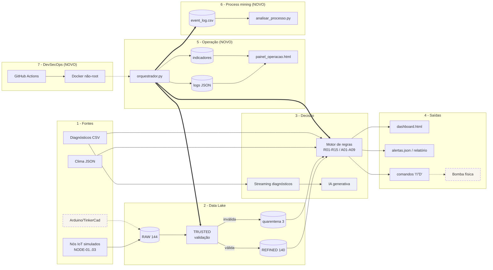

# AgroSmart: arquitetura final da solução (Fase 7)

> **Requisito 1.** Este documento consolida a arquitetura das Fases 4 a 6, feitas a partir da base entregue pelo Ryan, e marca como **NOVO (Fase 7)** tudo o que foi acrescentado nesta entrega.
> Diagrama editável: [`arquitetura_final.mmd`](arquitetura_final.mmd), em Mermaid, que renderiza no GitHub. O diagrama da Fase 6 continua em `4_Arquitetura_Solucao/diagrama_arquitetura.svg`.

## Diagrama

Legenda:
- **Linha cheia:** o caminho é executado pelo pipeline.
- **Tracejado:** proposto, sem execução nesta entrega.
- **Azul:** módulo que existe e funciona, mas roda separado do ciclo principal.

## Componentes

| # | Camada | Componente | Arquivo(s) | Situação |
|---|---|---|---|---|
| 1 | Fontes | Nós IoT simulados (3 talhões, 24 h, a cada 30 min, com falhas injetadas) | `5_Coleta_Dados_IoT/gerar_dados_simulados.py` | Fase 6, executado |
| 1 | Fontes | Firmware e circuito Arduino (TMP36, solo, LDR, PIR, botão de chuva, relé) | `5_Coleta_Dados_IoT/agrosmart_no_sensor.ino` | Proposto |
| 1 | Fontes | Clima: resposta de API em JSON (risco de chuva de 15% e máxima de 31 °C) | `2_Ingestao_.../exemplo_dados_api_clima.json` | Arquivo local, sem consulta ao vivo |
| 1 | Fontes | Diagnósticos de doença (14 amostras: Ferrugem, Antracnose, Míldio, Mancha Foliar) | `FIAP - Agrosmart Docker/dados_agricolas.csv` | Fase anterior |
| 2 | Data Lake | RAW: CSV como veio do gateway (11 colunas) | `dados_sensores_brutos.csv` | Fase 6 |
| 2 | Data Lake | TRUSTED: valida schema, campos vazios, tipos, faixas físicas e eventos 0/1, e remove duplicadas (`no_sensor` + `millis`) | `6_Processamento_Dados/processar_dados.py` | Fase 6 |
| 2 | Data Lake | REFINED: período, ponto de orvalho (Magnus-Tetens), VPD, média móvel do solo, `delta_solo`, horas de UR ≥ 85% e lacunas | `saida/dados_processados.csv`, `resumo_por_talhao.csv` | Fase 6 |
| 3 | Decisão | Motor inferencial: 15 regras de fato com encadeamento progressivo e 9 regras de ação, nos níveis NORMAL, ATENCAO, ALTO e CRITICO, com justificativa de cada alerta | `7_Automacao_Inteligente/motor_decisao.py` | Fase 6 |
| 3 | Decisão | Streaming de diagnósticos (`definir_acao`, limiar crítico de 25%) | `FIAP - Agrosmart Docker/automacao_streaming.py` | Fase anterior, container próprio |
| 3 | Decisão | IA generativa (relatório executivo; modo simulado sem chave) | `3_IA_Generativa_Apoio_Decisao/gerar_relatorio_ia.py` | Separado. Na Fase 7 só foi corrigido o ID do modelo |
| 4 | Saídas | Painel agronômico, alertas, relatório e fila de comandos | `7_Automacao_Inteligente/saida/*` | Fase 6 |
| 5 | Operação | Orquestrador: ciclos agendados, timeout e retentativa por etapa, falha isolada por ciclo, parada limpa (SIGTERM) | `8_Execucao_Monitorada/orquestrador.py` | **NOVO** |
| 5 | Operação | Logs estruturados em JSON Lines, com rotação | `8_Execucao_Monitorada/logger_json.py` | **NOVO** |
| 5 | Operação | Indicadores por ciclo, histórico, painel de operação e healthcheck | `8_Execucao_Monitorada/saida/*`, `healthcheck.py` | **NOVO** |
| 6 | Process mining | Event log por leitura, reconstruído das saídas sem alterar a lógica | `8_Execucao_Monitorada/event_log.py` | **NOVO** |
| 6 | Process mining | DFG, variantes, gargalos, desvios e tempo até o alerta | `9_Process_Mining/analisar_processo.py` | **NOVO** |
| 7 | DevSecOps | Imagem da plataforma integrada (slim, não-root, código só leitura, HEALTHCHECK) | `Dockerfile`, `docker-compose.yml`, `.dockerignore`, `.env.example` | **NOVO** |
| 7 | DevSecOps | CI com qualidade, segurança e container | `.github/workflows/devsecops.yml`, `pyproject.toml`, `tests/` | **NOVO** |

## Fluxo de dados, passo a passo

1. **Coleta.** Cada nó envia uma linha CSV a cada 30 min, e o gateway acrescenta `recebido_em`. Na entrega, `gerar_dados_simulados.py` gera 24 h de leituras de T1, T2 e T3 com seed 42, então o resultado é reproduzível. Ele também injeta 5 falhas de campo: TMP36 desconectado (−50 °C), campo vazio, linha truncada, reenvio duplicado e pacote perdido.
2. **Ingestão no ciclo.** O `orquestrador.py` dispara o ciclo. O intervalo é configurável, e com `--ciclos 0` o ciclo roda continuamente. Cada etapa roda num subprocesso isolado, com timeout e retentativa, e tudo é registrado no log JSON.
3. **Trusted.** O `processar_dados.py` confere o cabeçalho e valida cada linha. As 3 linhas inválidas vão para `quarentena.csv` com o motivo, e a duplicada é removida.
4. **Refined.** O script ordena as leituras por talhão e horário e calcula as variáveis derivadas. As 140 leituras válidas viram `dados_processados.csv`, e o resumo por talhão vira `resumo_por_talhao.csv`.
5. **Decisão.** O `motor_decisao.py` reproduz as leituras em ordem cronológica. Para cada uma, monta os fatos (leitura atual, janelas de 2 h e 24 h, clima e diagnósticos), aplica o encadeamento progressivo e emite um alerta só quando uma ação começa. Neste caso foram 8 alertas e 2 comandos `'I'` para o NODE-02.
6. **Saídas.** O motor grava `dashboard.html`, `alertas.json`, `relatorio_alertas.txt` e `comandos_atuadores.txt`. A fila de comandos é simulada e não é enviada pela Serial.
7. **Operação (NOVO).** O orquestrador lê as saídas e grava os indicadores do ciclo: raw, quarentena, duplicadas, válidos, alertas por nível, comandos, tempo por etapa e status. Também atualiza `historico_execucoes.csv` e `painel_operacao.html`. O `healthcheck.py` do Docker considera o serviço saudável se o último ciclo não falhou e é recente.
8. **Process mining (NOVO).** O `event_log.py` cruza raw, quarentena, refined e alertas e gera um caso por leitura. Em seguida, o `analisar_processo.py` calcula o fluxo, as variantes e os gargalos.
9. **DevSecOps (NOVO).** A cada push, o GitHub Actions roda:
   - lint e regras de segurança (ruff);
   - os 21 testes;
   - pip-audit;
   - Trivy no filesystem e na imagem;
   - o smoke test do container, que confere o usuário não-root, os números de referência e o healthcheck.

## Integrações e contratos (sem mudança de colunas)

| Origem → destino | Contrato |
|---|---|
| Gateway → RAW | `recebido_em,no_sensor,talhao,millis,temperatura_c,umidade_ar_pct,umidade_solo_pct,luminosidade_pct,movimento,chuva,bomba` |
| Trusted → quarentena | `linha_arquivo,talhao,motivo,conteudo_original` |
| Refined → motor | 20 colunas de `dados_processados.csv` (`data_hora` … `lacuna`) |
| Clima → motor | `previsao_proximas_24h.risco_chuva_pct`, `temperatura_maxima_celsius` |
| Diagnósticos → motor | `id_amostra,data_leitura,diagnostico,tipo,area_afetada` |
| Motor → atuador | `AAAA-MM-DD HH:MM  NODE-0X  'I'/'D'  (mensagem)` |
| Saídas → event log | `case_id,activity,timestamp,talhao,no_sensor,status,duracao_ms,motivo_desvio,ciclo_agendado,linha_arquivo` |
| Orquestrador → log | JSON por linha com `timestamp,nivel,componente,mensagem` e contexto (`execucao_id`, `ciclo`, `talhao`, `duracao_ms`, …) |

## Decisões e limites (declarados)

- **Dados de ambiente simulados**, de 17/05/2026, como na Fase 6. Não são medições reais.
- **Runtime só com a stdlib.** A imagem fica enxuta e não há dependência de runtime para auditar.
- **O código do Ryan não teve a lógica alterada.** Houve só três correções pontuais:
  - fallback de fonte no `gerar_diagrama.py`, que antes quebrava fora do Windows;
  - ID do modelo corrigido no `gerar_relatorio_ia.py`;
  - título do README.
- **IA generativa e streaming de diagnósticos continuam fora do ciclo principal**, por decisão do grupo. Os dois funcionam separados, como na Fase 6.
- **Ficam como propostas:** Arduino físico, envio Serial à bomba, API de clima ao vivo e câmeras.
