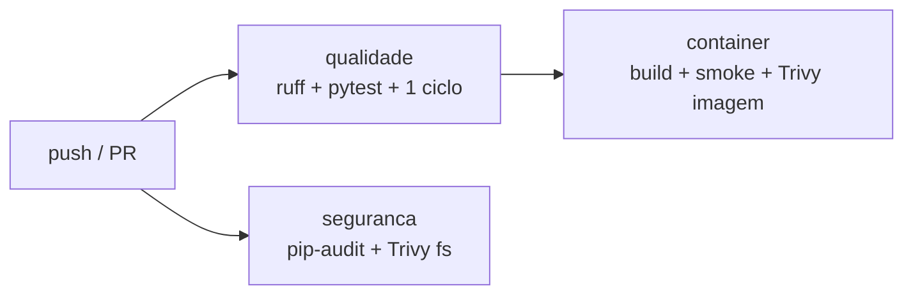

# Pipeline DevSecOps (Requisito 3)

Workflow: [`.github/workflows/devsecops.yml`](../.github/workflows/devsecops.yml). Ele dispara em todo push, em pull request e manualmente (`workflow_dispatch`). As permissões são mínimas: `contents: read`.



| Job | Etapa obrigatória | O que faz | Falha quando |
|---|---|---|---|
| `qualidade` | Qualidade de código | `ruff check` com as regras E/W/F/B/I e **S (bandit, segurança)**, em `pyproject.toml`. Roda `pytest` com 21 testes (unitários de validação, fórmulas e regras do motor, mais ponta a ponta) e publica o JUnit e as evidências de 1 ciclo como artifact | Há erro de lint ou um teste falha |
| `seguranca` | Vulnerabilidades | `pip-audit` em `requirements.txt` (runtime, `--strict`) e em `requirements-dev.txt`. O Trivy **filesystem** usa os scanners `vuln`, `secret` e `misconfig` (Dockerfile e compose), com severidade HIGH/CRITICAL e `ignore-unfixed` | Há CVE com correção disponível, segredo no código ou misconfig HIGH |
| `container` | Build | `docker build` da imagem da plataforma | O build quebra |
| `container` | Execução em container | Smoke test com três verificações: (1) `id -u` ≠ 0 (não-root); (2) 1 ciclo completo com `--gerar-dados` e checagem dos números de referência (144/3/1/140/8/2); (3) container em loop até o HEALTHCHECK ficar `healthy` | Roda como root, os números divergem ou o container não fica saudável |
| `container` | Vulnerabilidades | Trivy na **imagem** (sistema operacional e pacotes) | Há CVE HIGH/CRITICAL com correção disponível |

## Boas práticas aplicadas na imagem

| Prática | Onde |
|---|---|
| Base enxuta `python:3.12-slim` e nenhum pacote de runtime | `Dockerfile`, `requirements.txt` |
| Usuário de sistema **não-root** `agro` (uid 10001), com shell `nologin` | `Dockerfile` (`USER agro`) |
| Código pertence ao root (só leitura para a aplicação); só as pastas `saida/` e a 5 são graváveis | `Dockerfile` |
| `COPY` explícito e `.dockerignore` restritivo (sem `.git`, `.env`, testes, imagens ou PDFs) | `.dockerignore` |
| HEALTHCHECK que reflete o funcionamento real (último ciclo sem falha e recente) | `8_Execucao_Monitorada/healthcheck.py` |
| Configuração por variável de ambiente, `.env.example` versionado e `.env` no `.gitignore` | `.env.example`, `.gitignore` |
| Nenhum segredo no repositório; a chave da IA é opcional e só via ambiente | `.env.example`, `gerar_relatorio_ia.py` |
| `no-new-privileges`, `cap_drop: ALL` e parada limpa (`stop_grace_period`, tratamento de SIGTERM) | `docker-compose.yml`, `orquestrador.py` |
| O container legado também passou a rodar como não-root | `FIAP - Agrosmart Docker/Dockerfile` |

## Achado real do pip-audit durante a Fase 7

Na primeira execução, o pip-audit apontou **17 CVEs no `filelock` 4.1.0**. É uma dependência transitiva da própria ferramenta `pip-audit`, não do runtime. A correção está na 4.2.1, que exige Python ≥ 3.11.

A versão foi fixada em `requirements-dev.txt` com o marcador `python_version >= "3.11"`. O CI e o Docker usam 3.12, então ficam limpos. Num venv local com Python 3.10 o alerta continua, e isso está documentado. É um exemplo do ciclo detectar → corrigir → registrar.

## Como validar

1. Localmente:
   ```powershell
   python -m pip install -r requirements-dev.txt
   ruff check .
   python -m pytest -v
   pip-audit -r requirements.txt
   docker build -t agrosmart:fase7 .
   docker run --rm --entrypoint id agrosmart:fase7 -u          # deve imprimir 10001
   docker run --rm -e AGROSMART_CICLOS=1 agrosmart:fase7
   ```
2. No GitHub, abra **Actions → DevSecOps** e confira os 3 jobs verdes. Os artifacts `evidencias-qualidade` e `evidencias-container` trazem o JUnit, os logs, os indicadores e o event log gerados no CI.
3. O print da execução verde do Actions é a evidência para o PDF de entrega (ação humana).
