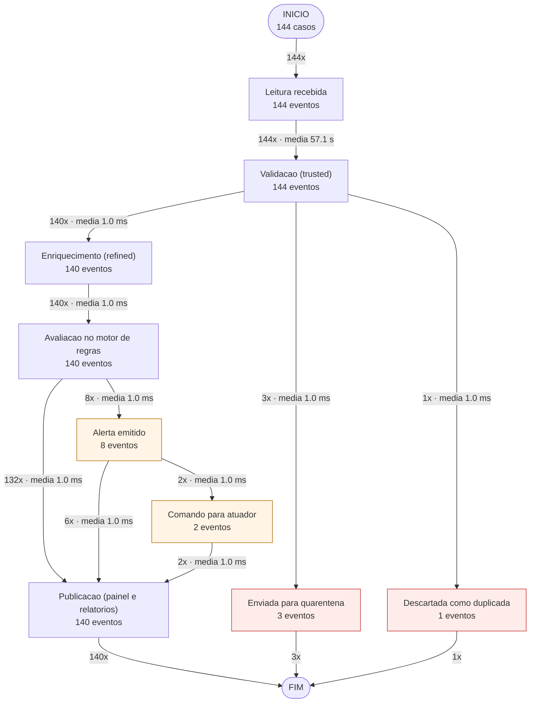

# Analise de processo (process mining) - AgroSmart

Gerado automaticamente em 24/11/2026 20:02 por `9_Process_Mining/analisar_processo.py`
a partir de `w.csv`. **Nao edite a mao.** A interpretacao fica em
`fase7_entrega/process_mining.md`.

## Visao geral

| Indicador | Valor |
|---|---|
| Casos (leituras de sensor) | 144 |
| Eventos | 722 |
| Atividades distintas | 9 |
| Variantes | 5 |
| Casos no caminho principal | 132 (91.7%) |
| Lead time medio (recebida -> fim) | 57.1 s |
| Lead time mediano | 57.0 s |
| Lead time maximo | 59.0 s |

## Atividades

| Atividade | Eventos | Casos | % dos casos |
|---|---|---|---|
| Leitura recebida | 144 | 144 | 100.0% |
| Validacao (trusted) | 144 | 144 | 100.0% |
| Enriquecimento (refined) | 140 | 140 | 97.2% |
| Avaliacao no motor de regras | 140 | 140 | 97.2% |
| Publicacao (painel e relatorios) | 140 | 140 | 97.2% |
| Alerta emitido | 8 | 8 | 5.6% |
| Enviada para quarentena | 3 | 3 | 2.1% |
| Comando para atuador | 2 | 2 | 1.4% |
| Descartada como duplicada | 1 | 1 | 0.7% |

## Variantes (caminhos do processo)

| # | Casos | % | Sequencia |
|---|---|---|---|
| V1 | 132 | 91.7% | Leitura recebida → Validacao (trusted) → Enriquecimento (refined) → Avaliacao no motor de regras → Publicacao (painel e relatorios) |
| V2 | 6 | 4.2% | Leitura recebida → Validacao (trusted) → Enriquecimento (refined) → Avaliacao no motor de regras → Alerta emitido → Publicacao (painel e relatorios) |
| V3 | 3 | 2.1% | Leitura recebida → Validacao (trusted) → Enviada para quarentena |
| V4 | 2 | 1.4% | Leitura recebida → Validacao (trusted) → Enriquecimento (refined) → Avaliacao no motor de regras → Alerta emitido → Comando para atuador → Publicacao (painel e relatorios) |
| V5 | 1 | 0.7% | Leitura recebida → Validacao (trusted) → Descartada como duplicada |

## Gargalos: espera entre atividades consecutivas

| De | Para | Freq. | Espera media | Mediana | Maxima |
|---|---|---|---|---|---|
| Leitura recebida | Validacao (trusted) | 144 | 57.1 s | 57.0 s | 59.0 s |
| Validacao (trusted) | Enriquecimento (refined) | 140 | 1.0 ms | 1.0 ms | 1.0 ms |
| Enriquecimento (refined) | Avaliacao no motor de regras | 140 | 1.0 ms | 1.0 ms | 1.0 ms |
| Avaliacao no motor de regras | Publicacao (painel e relatorios) | 132 | 1.0 ms | 1.0 ms | 1.0 ms |
| Avaliacao no motor de regras | Alerta emitido | 8 | 1.0 ms | 1.0 ms | 1.0 ms |
| Alerta emitido | Publicacao (painel e relatorios) | 6 | 1.0 ms | 1.0 ms | 1.0 ms |
| Validacao (trusted) | Descartada como duplicada | 1 | 1.0 ms | 1.0 ms | 1.0 ms |
| Validacao (trusted) | Enviada para quarentena | 3 | 1.0 ms | 1.0 ms | 1.0 ms |
| Alerta emitido | Comando para atuador | 2 | 1.0 ms | 1.0 ms | 1.0 ms |
| Comando para atuador | Publicacao (painel e relatorios) | 2 | 1.0 ms | 1.0 ms | 1.0 ms |

A transicao **Leitura recebida → Validacao (trusted)** responde por **100.0%** de todo o tempo de espera do processo.

## Desvios do caminho principal

| Atividade | Motivo | Casos |
|---|---|---|
| Enriquecimento (refined) | 60 min sem leitura anterior (pacote perdido/rejeitado) | 4 |
| Descartada como duplicada | mesmo no_sensor + millis ja recebido (reenvio do gateway) | 1 |
| Enviada para quarentena | temperatura_c=-50.0 fora da faixa [-10.0, 60.0] | 1 |
| Enviada para quarentena | campo vazio: umidade_solo_pct | 1 |
| Enviada para quarentena | linha incompleta (6 de 11 campos) | 1 |

## Tempo da leitura ate o alerta

| Caso | Talhao | Nivel | Alerta | Tempo desde a leitura |
|---|---|---|---|---|
| LEIT-0019 | T3 | ALTO | A08: Movimento noturno no talhao (possivel animal/invasao) | 55.0 s |
| LEIT-0098 | T1 | ATENCAO | A09: Falha de leitura no no de sensores | 55.0 s |
| LEIT-0080 | T3 | ATENCAO | A09: Falha de leitura no no de sensores | 56.0 s |
| LEIT-0103 | T2 | ALTO | A02: Estresse hidrico: solo seco sob calor/ar seco | 56.0 s |
| LEIT-0125 | T2 | ATENCAO | A09: Falha de leitura no no de sensores | 57.0 s |
| LEIT-0038 | T3 | ALTO | A06: Alto risco de doenca fungica | 59.0 s |
| LEIT-0069 | T2 | ATENCAO | A09: Falha de leitura no no de sensores | 59.0 s |
| LEIT-0134 | T2 | CRITICO | A01: Solo em nivel critico de umidade | 59.0 s |

## Por talhao

| Talhao | Casos | Descartados | Lacunas | Alertas | Comandos |
|---|---|---|---|---|---|
| T1 | 49 | 2 | 1 | 1 | 0 |
| T2 | 47 | 1 | 2 | 4 | 2 |
| T3 | 48 | 1 | 1 | 3 | 0 |

## Fluxo descoberto (DFG)

