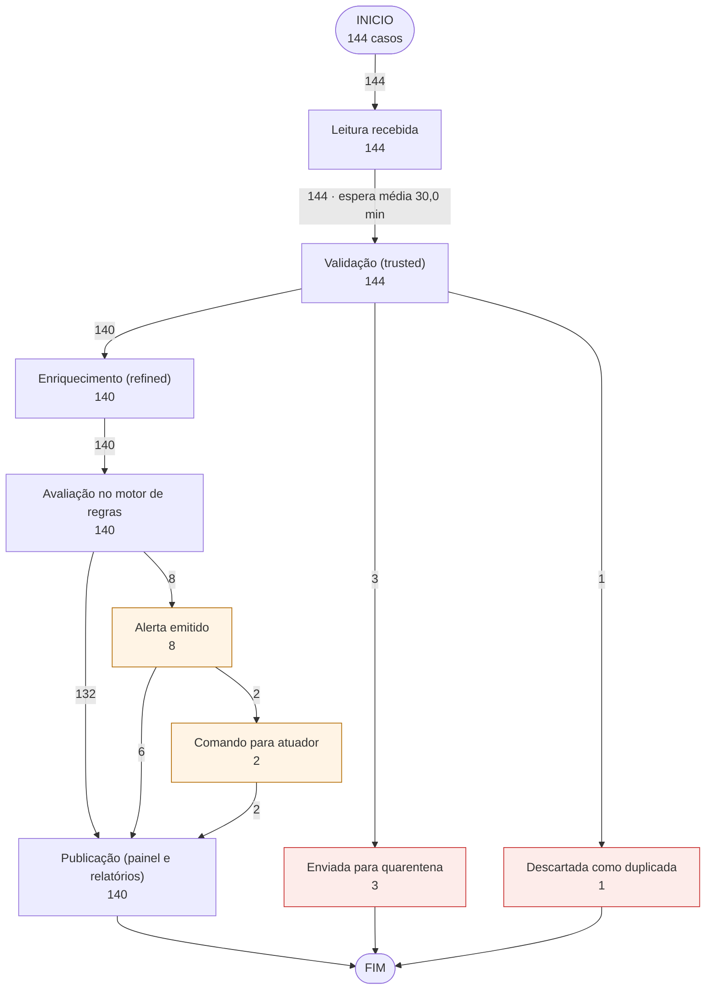

# Análise de processo: process mining (Requisito 5)

| | |
|---|---|
| **Event log** | `8_Execucao_Monitorada/saida/event_log.csv`, gerado a cada ciclo pelo orquestrador. A cópia de referência está em `fase7_entrega/evidencias/event_log.csv` |
| **Relatório gerado** | `9_Process_Mining/saida/analise_processo.md`, com DFG em Mermaid, `variantes.csv`, `transicoes.csv` e `etapas_ciclo.csv` |
| **Código** | `8_Execucao_Monitorada/event_log.py` (constrói o log) e `9_Process_Mining/analisar_processo.py` (DFG, variantes, performance e desvios, em Python puro) |

## 1. Como o event log foi construído (e o que é real ou simulado)

| Coluna | Origem |
|---|---|
| `case_id` | Uma leitura de sensor, `LEIT-<linha do arquivo raw>`. São 144 casos, incluindo a duplicada, que é um caso próprio |
| `activity` | Etapa do pipeline pela qual a leitura passou (9 atividades) |
| `timestamp` | **Leitura recebida** = `recebido_em` **real** do CSV bruto. **Demais atividades** = horário do **ciclo agendado** que processou a leitura (o próximo :00 ou :30, cadência igual à dos sensores). Isso é uma **simulação de agendamento em lote**, declarada |
| `talhao`, `no_sensor`, `linha_arquivo` | Dados reais do arquivo raw |
| `status` | OK, REJEITADA, DESCARTADA, LACUNA, nível do alerta (CRITICO/ALTO/ATENCAO) ou comando (`'I'`) |
| `duracao_ms` | Tempo **medido** da etapa no ciclo real, rateado por registro |
| `motivo_desvio` | Motivo da quarentena (texto do `processar_dados.py`), duplicidade, lacuna, ou id e mensagem do alerta |

O log é **reconstruído das saídas** do pipeline (raw, quarentena, refined e alertas), seguindo as mesmas regras do `processar_dados.py`. Nenhuma regra ou coluna do Ryan foi alterada. A consistência é testada: 144 casos, 3 quarentenas, 1 duplicada, 8 alertas, 2 comandos e tempo nunca retrocedendo dentro do caso.

## 2. Fluxo descoberto (Directly-Follows Graph)

## 3. Variações (variantes)

| Variante | Casos | % | Caminho | Significado |
|---|---|---|---|---|
| V1 | 132 | 91,7% | Recebida → Validação → Enriquecimento → Motor → Publicação | Leitura válida, sem ação |
| V2 | 6 | 4,2% | … → Motor → **Alerta** → Publicação | Alerta sem atuação (A06, A08, 4× A09) |
| V3 | 3 | 2,1% | Recebida → Validação → **Quarentena** | Leitura rejeitada |
| V4 | 2 | 1,4% | … → Motor → **Alerta** → **Comando 'I'** → Publicação | Intervenção automática (A02 e A01 em T2) |
| V5 | 1 | 0,7% | Recebida → Validação → **Duplicada** | Reenvio do gateway |

Outras 4 leituras seguem a V1, mas com `status = LACUNA` no enriquecimento: 60 min sem leitura anterior.

**Por talhão:**

| Talhão | Casos | Descartados | Lacunas | Alertas | Comandos |
|---|---|---|---|---|---|
| T1 | 49 | 2 | 1 | 1 | 0 |
| T2 | 47 | 1 | 2 | 4 | 2 |
| T3 | 48 | 1 | 1 | 3 | 0 |

O **T2 concentra metade dos alertas e todos os comandos**, por causa do sequeiro em dia quente e do solo saindo de 43% para 17%. Ele também tem o pacote perdido e uma quarentena.

## 4. Gargalos

| # | Achado (do log) | Evidência |
|---|---|---|
| G1 | **Espera em fila domina o processo.** A transição *Leitura recebida → Validação* responde por **100% do tempo de espera**, com 30,0 min em média, mediana e máximo. As etapas de processamento levam cerca de 1 ms por registro | Tabela "Gargalos" do `analise_processo.md` |
| G2 | **A causa é o alinhamento do agendamento, não a capacidade.** As leituras chegam de 1 a 5 s **depois** de :00/:30 (`recebido_em`), e o ciclo roda exatamente em :00/:30. Cada leitura perde o ciclo por segundos e espera o seguinte inteiro | Coluna `recebido_em` do raw vs. `ciclo_agendado` |
| G3 | **Falha de sensor só vira alerta uma leitura depois.** A leitura rejeitada às 10:30:01 (T2, −50 °C) gera o alerta A09 só na leitura das 11:00, processada às 11:30. São cerca de **60 min** entre a falha e o aviso. O mesmo vale para T3 (12:00 → 12:30) e T1 (15:00 → 15:30) | `quarentena.csv` × `linha_do_tempo` do `alertas.json` |
| G4 | **No ciclo real, o custo é iniciar processos, não calcular.** Cada etapa leva de 88 a 140 ms, a maior parte para subir o interpretador Python no subprocesso. A etapa `visualizacao`, que só prepara o replay HTML, consome de 14% a 17% do ciclo (medido em execuções distintas) sem influenciar a decisão | `etapas_ciclo.csv` / `event_log_ciclos.csv` |

## 5. Oportunidades de melhoria

**Técnicas:**

1. **Defasar o ciclo agendado em 60 s** (`AGROSMART_DEFASAGEM_AGENDAMENTO_S=60`), resolvendo G1 e G2. A simulação foi feita com o mesmo log: `python 8_Execucao_Monitorada/event_log.py --defasagem-s 60` e depois o `analisar_processo.py`.
   - O lead time médio cai de **30,0 min para 57,1 s**, uma redução de cerca de 96,8%.
   - O tempo da leitura até o alerta passa a ficar entre **55 e 59 s** para os 8 alertas.
   - Mudança de uma variável, sem custo.
2. **Alerta de falha no próprio evento de quarentena** (G3). Hoje a regra R15 olha "rejeitadas nas últimas 2 h" só quando chega a leitura seguinte. Disparar A09 junto com a quarentena antecipa a manutenção em cerca de 30 min.
3. **Execução em processo único** (G4). Importar os módulos em vez de criar um subprocesso por etapa, e tornar a `visualizacao` opcional, reduz o ciclo de cerca de 0,5 s para dezenas de ms. Isso só importa em escala, com muitos talhões ou ciclos de minutos.
4. **Robustez da transmissão.**
   - 2 das 3 quarentenas são de transmissão (campo vazio e linha truncada) e a duplicada é um reenvio. Um checksum e ACK por pacote no gateway, com retransmissão idempotente pela chave `no_sensor + millis` que o trusted já usa, reduziria V3, V5 e as lacunas.
   - A terceira quarentena (TMP36 a −50 °C) é de hardware. Ela pede um alerta de manutenção específico, separado de "falha de leitura".

**Operacionais:**

5. **Metade dos alertas (4 de 8) é de infraestrutura (A09), não agronômica.** Separar a fila "manutenção de sensores" da fila "agronomia" evita fadiga de alerta no produtor e direciona a equipe certa.
6. **Priorizar T2.** Ele concentra os alertas críticos e os dois comandos. Vale revisar a irrigação programada do sequeiro em dias com máxima prevista ≥ 31 °C, valor que já vem no JSON de clima.
7. **Medir a resposta humana.** O log termina na fila de comandos. Registrar "Alerta reconhecido" e "Ação executada em campo", com horário, permitiria achar o gargalo real seguinte, o tempo de reação da equipe, que hoje não é observável.

## 6. Limitações
- Os dados são a série **simulada** de 17/05/2026 (seed 42), não medições de campo.
- Os horários depois da recepção vêm de um **modelo de agendamento declarado**, e não de um relógio de produção. Os tempos de processamento são medidos, mas rateados por registro.
- O que os dados sustentam são as conclusões estruturais: variantes, desvios, a defasagem de agendamento e a latência do alerta de falha. Os valores absolutos de espera dependem do intervalo escolhido.
